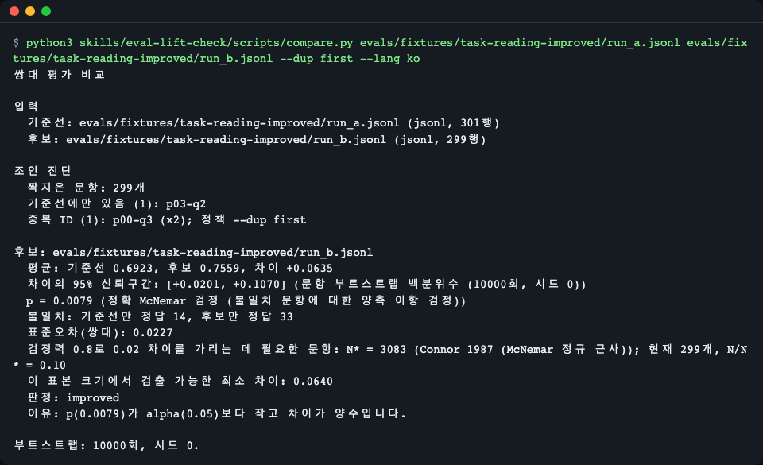
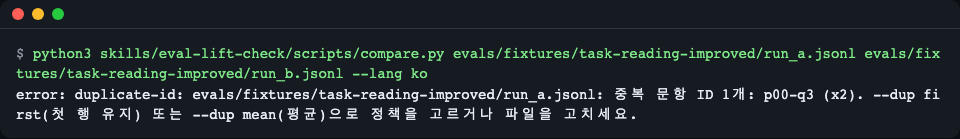
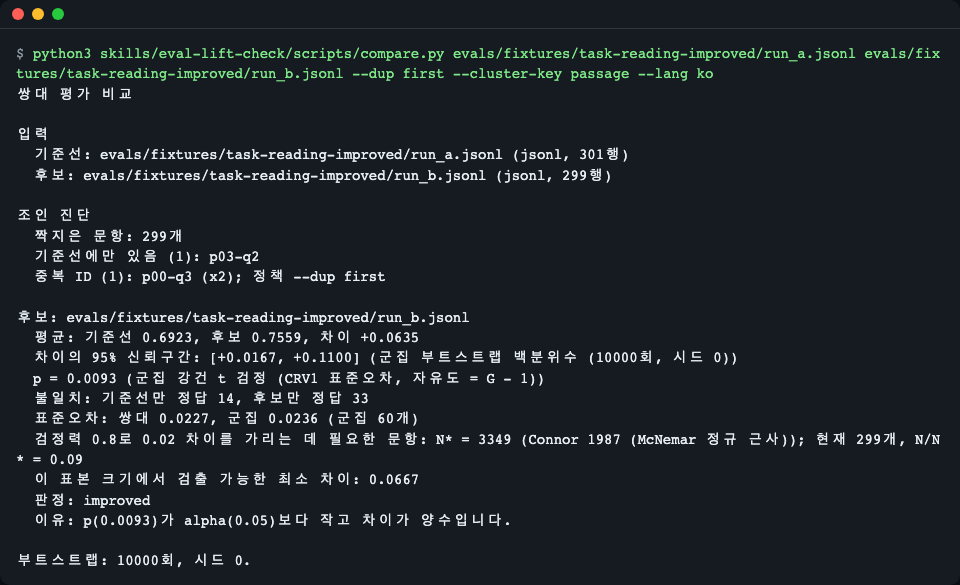
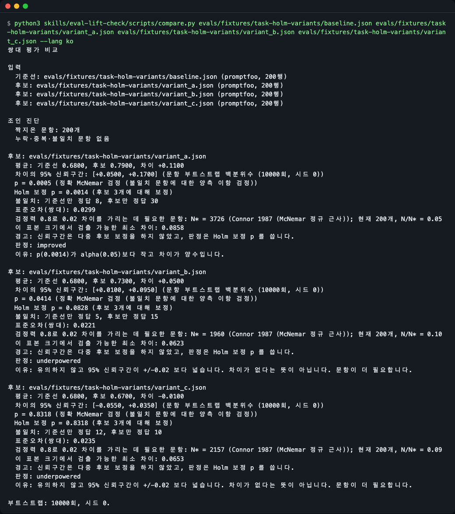
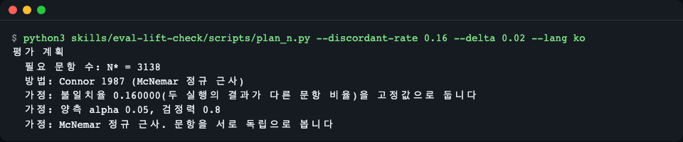
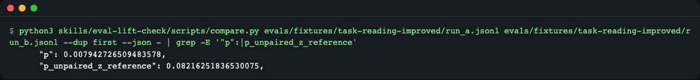
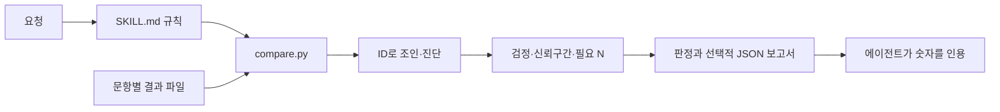

# eval-lift-check

[English](README.md) | **한국어**

평가를 다시 돌린 뒤 "B가 A보다 낫다"고 쓰려는 순간에 쓰는 에이전트 스킬입니다. 두 실행의 문항별 결과를 문항 ID로 짝짓고, 표준 라이브러리만 쓰는 스크립트(정확 McNemar 검정, 부트스트랩 신뢰구간, 군집 표준오차, 필요 표본 수, Holm 보정)로 계산해 `improved`, `regressed`, `bounded-null`, `underpowered` 중 하나로 판정합니다.


*저장소에 들어 있는 합성 픽스처: 조인 진단이 먼저, 이어서 평균·95% 신뢰구간·정확한 p 값·필요 문항 수·판정이 나옵니다.*

## What it does (무엇을 하나)
- **문항 ID로 짝짓고, 짝이 안 맞는 것을 알려 줍니다.** 누락 문항, 중복 ID, `doc_hash` 불일치, 문항당 에포크 수를 통계보다 먼저 출력합니다. 중복 ID는 조용히 합치지 않고 기본으로 실행을 멈춥니다.
- **알맞은 검정을 씁니다.** 0/1 점수는 정확 McNemar 검정(연속 점수는 쌍대 t 검정), 백분위 부트스트랩 신뢰구간, 문항들이 같은 출처를 공유하면 CRV1 군집 표준오차, 후보가 여럿이면 Holm 보정.
- **얼마나 더 필요한지 알려 줍니다.** Connor(1987) 기준 필요 문항 수, 검출 가능한 최소 차이, 그 방법과 가정을 함께 출력합니다(`plan_n.py` 는 평가를 돌리기 전에 쓰는 도구입니다).
- **과장하지 않습니다.** 데이터로 알 수 없으면 `underpowered` 이고, 스킬은 "차이 없음"이라고 쓰지 않도록 지시받습니다.
- **가진 형식을 그대로 읽습니다.** 일반 JSONL·CSV, lm-evaluation-harness 샘플, Inspect 로그(`.json`·`.eval`), promptfoo `results.json`·`.jsonl`.
- 출력은 영어·한국어(`--lang en|ko`). JSON 보고서에는 번역 문구가 없고, 같은 입력과 시드면 바이트까지 같습니다.

## Install (설치)
Python 3.10 이상만 있으면 됩니다(다른 패키지·네트워크 불필요). uv로 Python을 받으려면 `curl -LsSf https://astral.sh/uv/install.sh | sh` 후 `uv python install`, 최소 Debian·Ubuntu 이미지에서는 `apt-get install -y python3 git` 이면 충분합니다.

**Claude Code**
```
/plugin marketplace add LeeGyeongPil/eval-lift-check
/plugin install eval-lift-check@eval-lift-check-skill
```
**다른 에이전트(Agent Skills 표준)** — `skills/eval-lift-check` 폴더를 에이전트의 스킬 폴더(예: 프로젝트의 `.agents/skills/`)에 복사합니다. 동작 실측은 Claude Code 기준이며 다른 에이전트에서는 실측하지 않았습니다.

에이전트 없이 스크립트만 돌려도 됩니다. 저장소를 받아 루트에서 아래 명령을 실행하세요.
```
git clone https://github.com/LeeGyeongPil/eval-lift-check
cd eval-lift-check
```

## Use it (사용법)
에이전트에게 평소 말투로 요청하면 됩니다. 아래는 `evals/` 의 발동 케이스에서 가져온 문장입니다.

- "프롬프트 바꾸고 평가 다시 돌렸더니 68%에서 71%가 됐어. 진짜 좋아진 건지 확인해 줘."
- "두 모델 문항별 결과 jsonl 로 차이가 유의한지, 그리고 문항이 몇 개 더 필요한지 알려 줘."
- "How many eval items do I need to detect a 2-point accuracy difference between two models?" (2점 차이를 검출하려면 문항이 몇 개 필요한지 묻는 영어 요청)

요약이 아니라 문항별 결과가 필요합니다. `--lang` 이 없으면 `EVAL_LIFT_CHECK_LANG`, `LC_ALL`, `LC_MESSAGES`, `LANG` 순으로 언어를 정합니다(한국어가 아니면 영어).

### 빠른 시작 (약 0.3초, 설치 없음)
저장소에는 합성 픽스처가 들어 있습니다. 지문 60개와 지문당 몇 개의 문항, 실행 A와 B입니다. 실행 A에는 B에 없는 문항 하나와 두 번 나오는 ID 하나가 일부러 들어 있습니다.
```
$ python3 skills/eval-lift-check/scripts/compare.py evals/fixtures/task-reading-improved/run_a.jsonl evals/fixtures/task-reading-improved/run_b.jsonl --dup first --lang ko
쌍대 평가 비교

입력
  기준선: evals/fixtures/task-reading-improved/run_a.jsonl (jsonl, 301행)
  후보: evals/fixtures/task-reading-improved/run_b.jsonl (jsonl, 299행)

조인 진단
  짝지은 문항: 299개
  기준선에만 있음 (1): p03-q2
  중복 ID (1): p00-q3 (x2); 정책 --dup first

후보: evals/fixtures/task-reading-improved/run_b.jsonl
  평균: 기준선 0.6923, 후보 0.7559, 차이 +0.0635
  차이의 95% 신뢰구간: [+0.0201, +0.1070] (문항 부트스트랩 백분위수 (10000회, 시드 0))
  p = 0.0079 (정확 McNemar 검정 (불일치 문항에 대한 양측 이항 검정))
  불일치: 기준선만 정답 14, 후보만 정답 33
  표준오차(쌍대): 0.0227
  검정력 0.8로 0.02 차이를 가리는 데 필요한 문항: N* = 3083 (Connor 1987 (McNemar 정규 근사)); 현재 299개, N/N* = 0.10
  이 표본 크기에서 검출 가능한 최소 차이: 0.0640
  판정: improved
  이유: p(0.0079)가 alpha(0.05)보다 작고 차이가 양수입니다.

부트스트랩: 10000회, 시드 0.
```

### 단계별 따라 하기

**1. 무엇이 짝지어지고 무엇이 안 되는지 봅니다.** 같은 명령에서 `--dup` 만 뺍니다.
```
$ python3 skills/eval-lift-check/scripts/compare.py evals/fixtures/task-reading-improved/run_a.jsonl evals/fixtures/task-reading-improved/run_b.jsonl --lang ko
error: duplicate-id: evals/fixtures/task-reading-improved/run_a.jsonl: 중복 문항 ID 1개: p00-q3 (x2). --dup first(첫 행 유지) 또는 --dup mean(평균)으로 정책을 고르거나 파일을 고치세요.
```

*종료 코드 3. 오류는 중복 ID 전부와 선택지를 알려 줍니다. `first` 와 `mean` 중 무엇이 맞는지는 사용자가 정할 일이라 스크립트가 고르지 않습니다.*

**2. 같은 지문을 공유하는 문항을 반영합니다.** 같은 지문의 문항들은 서로 독립이 아닙니다. `--cluster-key passage` 를 주면 군집 기준 결과가 주 결과가 됩니다.
```
$ python3 skills/eval-lift-check/scripts/compare.py evals/fixtures/task-reading-improved/run_a.jsonl evals/fixtures/task-reading-improved/run_b.jsonl --dup first --cluster-key passage --lang ko
```

*표준오차가 0.0227(쌍대)에서 0.0236(군집 60개)으로 커지고, p 는 군집 t 검정의 0.0093, N* 는 3349로 늘어납니다.*

**3. 변형 여러 개를 비교합니다.** 후보가 둘 이상이면 p 값을 Holm 으로 보정하고, 판정은 보정한 값으로 합니다.
```
$ python3 skills/eval-lift-check/scripts/compare.py evals/fixtures/task-holm-variants/baseline.json evals/fixtures/task-holm-variants/variant_a.json evals/fixtures/task-holm-variants/variant_b.json evals/fixtures/task-holm-variants/variant_c.json --lang ko
```

*변형 B 는 원래 p = 0.0414 지만 Holm 보정 p = 0.0828 이라 `improved` 가 아니라 `underpowered` 입니다. 더 낫다고 말할 수 있는 것은 변형 A(보정 p = 0.0014)뿐입니다.*

**4. 평가를 돌리기 전에 크기를 가늠합니다.**
```
$ python3 skills/eval-lift-check/scripts/plan_n.py --discordant-rate 0.16 --delta 0.02 --lang ko
평가 계획
  필요 문항 수: N* = 3138
  방법: Connor 1987 (McNemar 정규 근사)
  가정: 불일치율 0.160000(두 실행의 결과가 다른 문항 비율)을 고정값으로 둡니다
  가정: 양측 alpha 0.05, 검정력 0.8
  가정: McNemar 정규 근사. 문항을 서로 독립으로 봅니다
```

*실행 사이에 결과가 달라지는 문항이 16% 일 때 2점 차이를 검출하려면 약 3,100문항이 필요합니다.*

**5. 왜 평균만 비교하면 안 되나요?** 두 실행을 서로 무관한 표본으로 보면, 같은 문항에 답했다는 사실을 버리게 됩니다. 이 데이터에는 맞지 않는 그 값을 보고서가 참고용으로 함께 남깁니다.
```
$ python3 skills/eval-lift-check/scripts/compare.py evals/fixtures/task-reading-improved/run_a.jsonl evals/fixtures/task-reading-improved/run_b.jsonl --dup first --json - | grep -E '"p":|p_unpaired_z_reference'
      "p": 0.007942726509483578,
      "p_unpaired_z_reference": 0.08216251836530075,
```

*같은 데이터, 다른 결론: 비쌍대 z 검정은 p = 0.082(유의하지 않음), 불일치 47개에 대한 정확 McNemar 검정은 p = 0.0079 입니다. 쌍대 검정은 대부분의 문항을 두 실행이 같은 결과로 푼다는 정보를 씁니다.*

## Supported inputs (지원 입력 형식)
형식은 확장자와 키로 감지하며, `--format` 으로 직접 지정할 수 있습니다. 실제로 쓴 형식은 보고서의 `inputs[].format_detected` 에 기록됩니다.

| 형식 | 넘길 것 | 주요 옵션 | 알려진 함정 |
|---|---|---|---|
| JSONL / CSV / JSON 목록 | 문항당 한 행: `{"id": "p00-q3", "passage": "p00", "score": 1}` | `--id-key`, `--score-key`, `--cluster-key`, `--dup` | 중복 ID 는 `--dup first` 나 `mean` 을 고르지 않으면 실행이 멈춤 |
| lm-evaluation-harness | `--log_samples` 가 쓰는 `samples_<task>_<timestamp>.jsonl`, 파일 하나 또는 폴더 | `--metric` | `doc_id` 가 태스크마다 0부터 다시 시작해서 키는 `<task>/<doc_id>`, 태스크가 여럿이면 판정은 하나(전체 합동)이고 태스크별 줄은 Holm 보정된 보조 결과(가장 좋은 태스크만 고르지 말 것), `doc_hash` 가 다른 문항은 제외하고 목록으로 알림 |
| Inspect | JSON 로그 또는 `.eval` 묶음 | `--metric`, `--epochs mean\|cluster` | zstd 로 압축된 `.eval` 은 Python 3.14 이상 필요, 더 낮은 버전은 쓸 `inspect log dump` 명령을 알려 줌. `--epochs cluster` 면 요약에 두 수가 함께 나옴(예: `짝지은 문항: 30개 (문항×에포크 90행, 에포크마다 한 행)`) |
| promptfoo | `results.json` 또는 `results.jsonl` | `--id-key`, `--score-key score`, `--prompt-idx` | 프롬프트가 여럿인 파일은 경고하며, `--prompt-idx` 로 하나를 고름 |

점수는 불리언, 숫자, `true`/`false`, `pass`/`fail`, `yes`/`no`, `correct`/`incorrect`, `C`/`I` 를 받습니다. 모든 점수가 0 또는 1 이면 이진 데이터(정확 McNemar), 아니면 연속 점수(쌍대 t 검정)입니다. 자세한 설명과 예: [`skills/eval-lift-check/references/formats.md`](skills/eval-lift-check/references/formats.md).

## How the verdict is decided (판정 규칙)
규칙은 `_verdict.py` 에 고정되어 있고, 에이전트는 결과를 인용만 합니다. 기본값: `--alpha 0.05`, `--power 0.8`, `--margin 0.02`(2점, 0/1 점수만. 연속 점수는 `--margin` 을 줘야 함).

| 판정 | 조건 | 에이전트가 말하도록 지시받은 내용 |
|---|---|---|
| `improved` | p(후보가 여럿이면 Holm 보정값)가 alpha 보다 작고 차이가 양수 | "X점 개선(95% 신뢰구간 a~b, p = ...)" |
| `regressed` | p 가 alpha 보다 작고 차이가 음수 | 같은 형식, 부호만 반대 |
| `bounded-null` | 유의하지 않고, 부트스트랩 95% 신뢰구간과 분석적 확인 구간(0/1 점수: 쌍대 비율 Tango 점수 구간, 연속 점수: t 구간)이 **둘 다** margin 안에 있음 | "차이가 있더라도 margin 보다 작다" |
| `underpowered` | 그 외 전부 | "데이터로는 알 수 없다", N* 와 N/N* 함께, "차이 없음"은 절대 쓰지 않음 |

"margin"은 무시해도 되는 가장 큰 차이입니다. `bounded-null` 만 "의미 있는 차이가 없다"를 뒷받침합니다. 두 구간이 모두 margin 보다 큰 차이를 배제하기 때문입니다. 유의하지 않지만 구간이 넓으면 `underpowered` 입니다.

구간을 두 개 보는 이유: 문항이 적고 불일치가 하나도 없으면 부트스트랩으로 다시 뽑은 표본마다 차이가 똑같아서, 부트스트랩 구간이 `[+0.0000, +0.0000]` 으로 쪼그라듭니다. Tango 구간은 쪼그라들지 않습니다. 그래서 10문항에서 점수가 똑같은 두 실행은 `bounded-null` 이 아니라 `underpowered` 입니다(똑같은 10문항 실행 결과의 마지막 줄들).
```
  차이의 95% 신뢰구간: [+0.0000, +0.0000] (문항 부트스트랩 백분위수 (10000회, 시드 0))
  p = 1.0000 (정확 McNemar 검정 (불일치 문항에 대한 양측 이항 검정))
  불일치: 기준선만 정답 0, 후보만 정답 0
  표준오차(쌍대): 0.0000
  필요 문항 수: 계산 불가 (불일치율이 한계값 이하)
  경고: 두 실행 사이에 결과가 다른 문항이 없어 정확 검정으로 아무것도 기각할 수 없습니다.
  경고: 관측된 불일치율이 한계(margin)보다 크지 않아 Connor 공식으로 필요 문항 수를 구할 수 없습니다. 이 불일치율도 추정값이라 문항이 적으면 실제 비율은 훨씬 높을 수 있습니다.
  판정: underpowered
  이유: 유의하지 않습니다. 부트스트랩 신뢰구간은 +/-0.02 안에 있지만 쌍대 비율 Tango 점수 구간 [-0.2775, +0.2775] 는 그 밖으로 나갑니다. 문항이나 불일치가 너무 적어 그만한 차이를 배제할 수 없습니다. 차이가 없다는 뜻이 아닙니다. 문항이 더 필요합니다.
```
불일치가 0개면 189문항이 있어야 2점 margin 을 배제할 수 있습니다(똑같은 188문항은 아직 `underpowered`). 저장소의 2000문항 픽스처 `tests/fixtures/bounded_null/`(불일치 122개, 신뢰구간 [-0.0105, +0.0120])은 `bounded-null` 입니다. 출처: Tango(1998), https://doi.org/10.1002/(SICI)1097-0258(19980430)17:8%3C891::AID-SIM780%3E3.0.CO;2-B , Fagerland·Lydersen·Laake(2014), https://doi.org/10.1002/sim.6148 (2026-11-27 확인).

## Statistics in plain words (쉬운 통계 설명)
- **짝짓기.** 두 실행이 같은 문항에 답했으므로 문항마다 점수 한 쌍이 생깁니다. 쌍으로 비교하면 두 평균이 함께 가진 문항별 난이도 차이가 사라집니다.
- **불일치 문항.** 둘 다 맞히거나 둘 다 틀린 문항은 누가 낫다고 알려 주지 않습니다. 결과가 갈린 문항만 셉니다. `b` = 기준선만 정답, `c` = 후보만 정답(예시에서 14와 33).
- **정확 McNemar 검정.** 진짜 차이가 없다면 불일치 문항 하나하나는 두 실행 중 누구 쪽이든 동전 던지기입니다. p 값은 그 동전으로 14 대 33 이상으로 한쪽에 쏠릴 확률(양측 이항 검정)입니다. 정규 근사는 쓰지 않습니다. 출처: McNemar(1947), Miller(2024), https://arxiv.org/abs/2411.00640 (2026-11-27 확인).
- **부트스트랩 구간.** 문항(또는 군집 전체)을 고정 시드로 10,000번 다시 뽑아, 차이의 2.5% 와 97.5% 지점을 읽습니다.
- **군집 표준오차.** 한 지문에 달린 문항들은 비슷하게 맞히거나 틀리는 경향이 있어 서로 독립이 아닙니다. 독립으로 보면 오차를 작게 잡게 됩니다. CRV1 표준오차는 `--cluster-key` 로 문항을 묶어 구간을 그만큼 넓힙니다.
- **필요 N.** 정한 검정력으로 주어진 차이를 검출하는 데 필요한 문항 수입니다(Connor 1987, McNemar 정규 근사). 두 실행이 얼마나 자주 갈리는지에 달려 있어, 출력이 쓴 가정을 함께 밝힙니다.
- **Holm 보정.** 후보 여러 개를 기준선 하나와 비교하면 가장 작은 원래 p 값은 낙관적입니다. Holm(1979)은 p 값을 조정해 "개선"이 한 번이라도 거짓일 확률을 alpha 로 유지합니다.

공식과 출처: [`skills/eval-lift-check/references/statistics.md`](skills/eval-lift-check/references/statistics.md).

## Verified behavior (검증된 동작)
<!-- skill-eval:start -->
| 확인 | 결과 |
|---|---|
| 필요할 때 불림 | 12/12 |
| 필요 없을 때 안 불림 | 10/10 |
| 스킬로 푼 작업 | 7/7 |
| 스킬 없이 푼 작업(기준선) | 0/7 |
| 평균 점수 차이(Δ) | +0.68 |
| 가짜 스크립트를 잡아낸 비율 | 7/7 |
| Codex CLI | 미검증 |

Claude Code 2.1.332 · sonnet · 케이스마다 3회 · 2026-11-27 측정 · codex-cli 0.154.0
<!-- skill-eval:end -->

표 읽는 법: 발동 프롬프트와 근접(발동하면 안 되는) 프롬프트는 `evals/` 에 있습니다. 답이 스크립트가 출력한 정확한 값을 인용하면 작업을 푼 것으로 셉니다. "기준선"은 스킬 없이 같은 에이전트로 푼 결과입니다. "가짜 스크립트를 잡아낸 비율"은 통계 코드를 일부러 망가뜨린 사본을 쓰면 작업 검사가 실패하는지 본 것입니다. 다른 에이전트에서의 동작은 실측하지 않았습니다.

## How it works (동작 원리)

1. `SKILL.md` 가 에이전트에게 스크립트를 언제 돌리고 판정을 어떻게 말할지 알려 줍니다.
2. `compare.py` 는 지정한 파일만 읽고, 형식을 감지해 실행들을 ID로 조인합니다.
3. 진단(누락·중복·해시 불일치·에포크)을 먼저 출력합니다.
4. 통계 코드는 `_stats.py` 에 있고, `tests/oracle/` 의 scipy·statsmodels 값과 대조합니다.
5. 판정은 `_verdict.py` 의 고정 규칙에서 나오며, 에이전트는 그것을 인용만 합니다.

범위와 권한: 표준 라이브러리만 쓰고 네트워크 접근과 셸 호출이 없습니다. `--json PATH` 를 줄 때만 파일을 씁니다. 공식과 출처는 `skills/eval-lift-check/references/statistics.md` 에 있습니다.

## When to use it (언제 쓰나)
- 잘 맞는 경우: 프롬프트·모델·체크포인트·스킬을 바꿨고, 두 실행의 문항별 결과가 있으며, 개선이 진짜인지 또는 문항이 몇 개 더 필요한지 알고 싶을 때.
- 맞지 않는 경우: 실행 하나의 채점, 심사 기준표 작성, 심사자-사람 일치도, 평가 실행 자체, 고정 임계값 CI 게이트, 독립 표본 A/B 검정(군마다 문항이 다른 경우).
- 평가를 돌리는 도구는 [lm-evaluation-harness](https://github.com/EleutherAI/lm-evaluation-harness), [Inspect](https://inspect.aisi.org.uk/), [promptfoo](https://www.promptfoo.dev/) 를 보세요. 이 스킬은 그 출력을 읽습니다.

## Related tools (관련 도구)
평가 결과에 대한 쌍대 유의성 검정은 이미 라이브러리와 CLI 로 존재합니다. 통계를 직접 코드에서 부르고 싶다면 좋은 선택지입니다. 각각이 지금 무엇을 지원하는지는 해당 README 를 확인하세요.

- [abeval](https://github.com/mohammadi-hadi/abeval), [paired-eval](https://github.com/alloevil/paired-eval), [evalci](https://github.com/Shreyaskc/evalci), [evalsig](https://github.com/HZDF-2026/evalsig)
- lm-evaluation-harness `scripts/model_comparator.py`: 같은 문항에서 돌린 실행을 비교하는 방법에 대한 [이슈 #3831](https://github.com/EleutherAI/lm-evaluation-harness/issues/3831) 논의를 참고하세요(링크 2026-11-27 확인).

이 프로젝트가 더하는 것은 새로운 통계가 아니라 다른 포장입니다. 판정 문구 규칙이 있는 에이전트 스킬이고, lm-eval·Inspect·promptfoo 출력을 바로 읽고, 검정 전에 조인 진단(누락·중복·해시 불일치 문항)을 출력하고, 필요 N 의 가정을 밝힙니다.

## Fixtures are synthetic (픽스처는 합성 데이터)
`evals/fixtures/` 와 `tests/fixtures/` 의 합성 폴더에 있는 것은 모두 시드를 고정한 스크립트가 만든 가짜 데이터라서, 실제 모델 결과는 공개하지 않습니다. 저장소 루트에서 다시 만들 수 있습니다.
```
python3 tests/fixtures/make_fixtures.py
```
`tests/fixtures/real/` 의 파일만 예외로, Inspect(0.3.292)와 promptfoo(0.126.0)의 실제 출력입니다. 결정적 채점기를 쓰고 모델 호출은 없으며, 어댑터가 실제 형식을 읽는지 확인하는 용도입니다.

## Development (개발)
```
uv sync && uv run pytest -q
```
마지막 줄이 `173 passed` 면 됩니다(Python 3.10 에서는 zstd 테스트 하나를 건너뛰어 `172 passed, 1 skipped`).

`evals/` 는 평가 세트입니다: 발동해야 하는 프롬프트(영어·한국어), 발동하면 안 되는 근접 프롬프트, 픽스처와 정확한 값 검사가 있는 작업 케이스. 저장소 루트에서 `claude plugin eval` 로 돌립니다. `uv run tests/oracle/crosscheck.py` 는 오라클 값을 다시 만듭니다(개발 전용, scipy·statsmodels 필요).

## License
MIT
