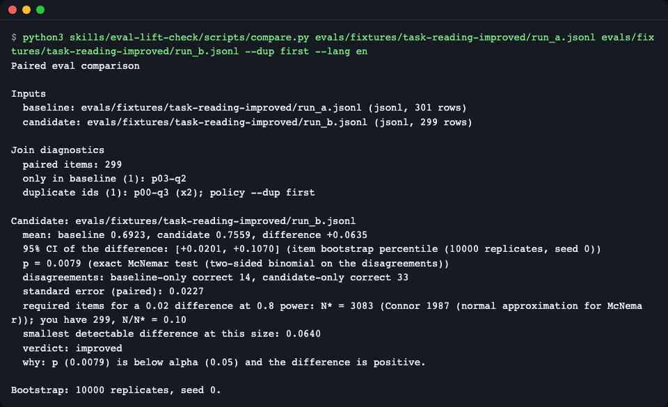
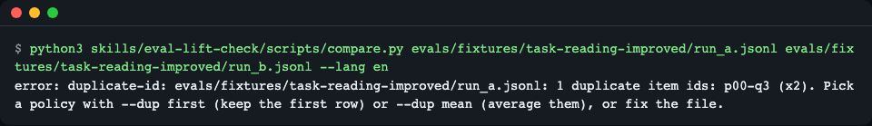
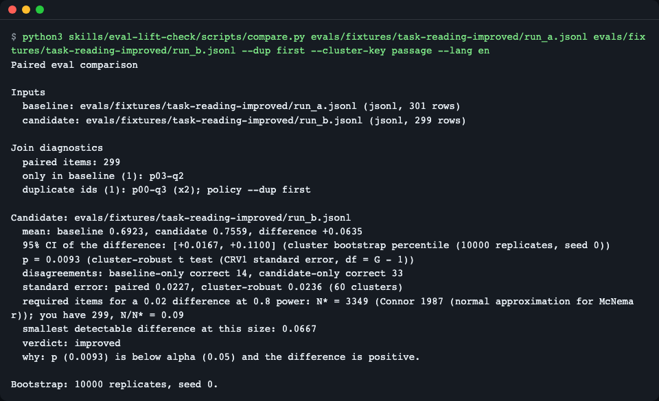
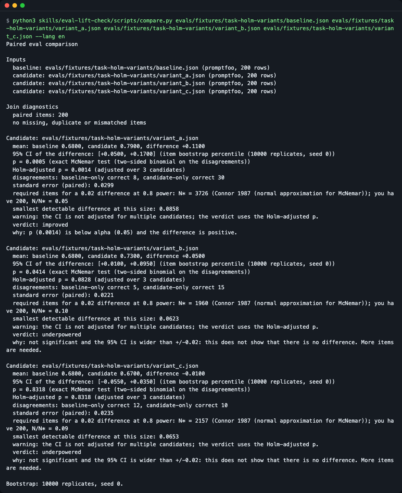
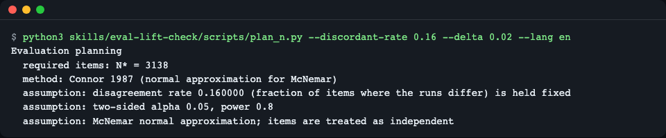
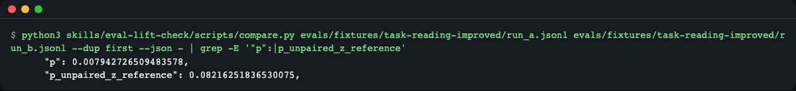
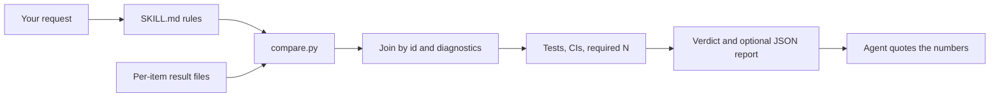

# eval-lift-check

**English** | [한국어](README.ko.md)

An agent skill for the moment you re-run an eval and want to write "B beats A". It pairs the per-item results of the two runs by item id, runs bundled standard-library scripts (exact McNemar test, bootstrap intervals, cluster-robust errors, required sample size, Holm correction), and returns one verdict: `improved`, `regressed`, `bounded-null` or `underpowered`.


*The bundled synthetic fixture: the join diagnostics come first, then the means, the 95% CI, the exact p value, the required N and the verdict.*

## What it does
- **Pairs by item id and tells you what did not pair.** Missing items, duplicate ids, `doc_hash` mismatches and epochs per item are printed before any statistics. Duplicates stop the run by default instead of being merged silently.
- **Tests the right thing.** Exact McNemar test for 0/1 scores (or a paired t test for continuous scores), percentile bootstrap intervals, CRV1 cluster-robust standard errors when items share a source, Holm correction when several candidates are compared with one baseline.
- **Says how much data you would need.** Required N after Connor (1987), the smallest detectable difference, and the method and assumptions behind them (`plan_n.py` does this before you run the eval).
- **Refuses to overclaim.** If the data cannot tell, the verdict is `underpowered` and the skill is told never to write "no difference".
- **Reads what you already have.** Generic JSONL and CSV, lm-evaluation-harness samples, Inspect logs (`.json` and `.eval`), promptfoo `results.json` and `.jsonl`.
- Output in English or Korean (`--lang en|ko`); the JSON report has no translated text and is byte-identical for the same input and seed.

## Install
Requires Python 3.10+ (nothing else, no network access). To get Python with uv: `curl -LsSf https://astral.sh/uv/install.sh | sh` then `uv python install`; on a minimal Debian or Ubuntu image `apt-get install -y python3 git` is enough.

**Claude Code**
```
/plugin marketplace add LeeGyeongPil/eval-lift-check
/plugin install eval-lift-check@eval-lift-check-skill
```
**Other agents (Agent Skills standard)** — copy `skills/eval-lift-check` into the agent's skills folder (for example `.agents/skills/` in a project). Behaviour was measured only with Claude Code; it was not measured in other agents.

You can also run the scripts without any agent. Clone the repo and run the commands below from its root:
```
git clone https://github.com/LeeGyeongPil/eval-lift-check
cd eval-lift-check
```

## Use it
Ask the agent in plain words. These prompts are taken from the trigger cases in `evals/`:

- "I changed the system prompt and re-ran the eval: 70.1% -> 72.4%. Is that a real improvement?"
- "How many eval items do I need to detect a 2-point accuracy difference between two models?"
- "Before I write in the PR description that the new retriever improves answer accuracy, check whether the eval results back that up."

The skill needs the per-item results, not the summary. Without a `--lang` flag the language follows `EVAL_LIFT_CHECK_LANG`, then `LC_ALL`, `LC_MESSAGES`, `LANG` (English unless Korean).

### Quick start (about 0.3 s, no install)
The repo ships a synthetic fixture: 60 passages, a few questions each, run A and run B. Run A has one question that run B lacks and one id that appears twice, on purpose.
```
$ python3 skills/eval-lift-check/scripts/compare.py evals/fixtures/task-reading-improved/run_a.jsonl evals/fixtures/task-reading-improved/run_b.jsonl --dup first --lang en
Paired eval comparison

Inputs
  baseline: evals/fixtures/task-reading-improved/run_a.jsonl (jsonl, 301 rows)
  candidate: evals/fixtures/task-reading-improved/run_b.jsonl (jsonl, 299 rows)

Join diagnostics
  paired items: 299
  only in baseline (1): p03-q2
  duplicate ids (1): p00-q3 (x2); policy --dup first

Candidate: evals/fixtures/task-reading-improved/run_b.jsonl
  mean: baseline 0.6923, candidate 0.7559, difference +0.0635
  95% CI of the difference: [+0.0201, +0.1070] (item bootstrap percentile (10000 replicates, seed 0))
  p = 0.0079 (exact McNemar test (two-sided binomial on the disagreements))
  disagreements: baseline-only correct 14, candidate-only correct 33
  standard error (paired): 0.0227
  required items for a 0.02 difference at 0.8 power: N* = 3083 (Connor 1987 (normal approximation for McNemar)); you have 299, N/N* = 0.10
  smallest detectable difference at this size: 0.0640
  verdict: improved
  why: p (0.0079) is below alpha (0.05) and the difference is positive.

Bootstrap: 10000 replicates, seed 0.
```

### Step by step

**1. See what pairs and what does not.** Run the same command without `--dup`:
```
$ python3 skills/eval-lift-check/scripts/compare.py evals/fixtures/task-reading-improved/run_a.jsonl evals/fixtures/task-reading-improved/run_b.jsonl --lang en
error: duplicate-id: evals/fixtures/task-reading-improved/run_a.jsonl: 1 duplicate item ids: p00-q3 (x2). Pick a policy with --dup first (keep the first row) or --dup mean (average them), or fix the file.
```

*Exit code 3. The error lists every duplicate id and the options. Choosing between `first` and `mean` is a decision for you, so the script does not make it.*

**2. Account for questions that share a passage.** Questions about the same passage are not independent. Pass `--cluster-key passage` and the cluster-robust result becomes the primary one:
```
$ python3 skills/eval-lift-check/scripts/compare.py evals/fixtures/task-reading-improved/run_a.jsonl evals/fixtures/task-reading-improved/run_b.jsonl --dup first --cluster-key passage --lang en
```

*The standard error grows from 0.0227 (paired) to 0.0236 (60 clusters), p becomes 0.0093 from a cluster-robust t test, and N* grows to 3349.*

**3. Compare several variants.** With more than one candidate, p values are Holm-adjusted and the verdict uses the adjusted value:
```
$ python3 skills/eval-lift-check/scripts/compare.py evals/fixtures/task-holm-variants/baseline.json evals/fixtures/task-holm-variants/variant_a.json evals/fixtures/task-holm-variants/variant_b.json evals/fixtures/task-holm-variants/variant_c.json --lang en
```

*Variant B has raw p = 0.0414 but Holm-adjusted p = 0.0828, so it is `underpowered`, not `improved`. Only variant A (adjusted p = 0.0014) can be called better.*

**4. Size the next eval before you run it.**
```
$ python3 skills/eval-lift-check/scripts/plan_n.py --discordant-rate 0.16 --delta 0.02 --lang en
Evaluation planning
  required items: N* = 3138
  method: Connor 1987 (normal approximation for McNemar)
  assumption: disagreement rate 0.160000 (fraction of items where the runs differ) is held fixed
  assumption: two-sided alpha 0.05, power 0.8
  assumption: McNemar normal approximation; items are treated as independent
```

*Detecting a 2-point difference when 16% of items differ between runs takes about 3,100 items.*

**5. Why not just compare averages?** Treating the two runs as unrelated samples ignores that both answered the same questions. The report keeps that wrong-for-this-data number as a reference:
```
$ python3 skills/eval-lift-check/scripts/compare.py evals/fixtures/task-reading-improved/run_a.jsonl evals/fixtures/task-reading-improved/run_b.jsonl --dup first --json - | grep -E '"p":|p_unpaired_z_reference'
      "p": 0.007942726509483578,
      "p_unpaired_z_reference": 0.08216251836530075,
```

*Same data, two conclusions: the unpaired z test gives p = 0.082 (not significant), the exact McNemar test on the 47 disagreements gives p = 0.0079. The paired test uses the information that most questions are answered the same way by both runs.*

## Supported inputs
The format is detected from the extension and keys; `--format` makes it explicit. The report records what was used in `inputs[].format_detected`.

| Format | What to pass | Key options | Known pitfalls |
|---|---|---|---|
| JSONL / CSV / JSON list | one row per item: `{"id": "p00-q3", "passage": "p00", "score": 1}` | `--id-key`, `--score-key`, `--cluster-key`, `--dup` | duplicate ids stop the run unless you pick `--dup first` or `mean` |
| lm-evaluation-harness | `samples_<task>_<timestamp>.jsonl` from `--log_samples`, a file or a folder | `--metric` | `doc_id` restarts in every task, so the key is `<task>/<doc_id>`; with several tasks you get one pooled verdict plus per-task lines (Holm-adjusted, secondary, do not pick the best task); items whose `doc_hash` differs are excluded and listed |
| Inspect | JSON log or `.eval` archive | `--metric`, `--epochs mean\|cluster` | zstd-compressed `.eval` needs Python 3.14+, older Pythons print the `inspect log dump` command to use; with `--epochs cluster` the summary shows both counts, for example `paired items: 30 (90 item-epoch rows, one row per epoch)` |
| promptfoo | `results.json` or `results.jsonl` | `--id-key`, `--score-key score`, `--prompt-idx` | a file with several prompts warns; pick one with `--prompt-idx` |

Scores may be booleans, numbers, `true`/`false`, `pass`/`fail`, `yes`/`no`, `correct`/`incorrect`, `C`/`I`. If every score is 0 or 1 the data is binary (exact McNemar), otherwise continuous (paired t test). Details and examples: [`skills/eval-lift-check/references/formats.md`](skills/eval-lift-check/references/formats.md).

## How the verdict is decided
The rules are fixed in `_verdict.py`; the agent only quotes the result. Defaults: `--alpha 0.05`, `--power 0.8`, `--margin 0.02` (2 points, 0/1 scores only; continuous scores need `--margin`).

| Verdict | Condition | What the agent is told to say |
|---|---|---|
| `improved` | p (Holm-adjusted for several candidates) is below alpha and the difference is positive | "improved by X points (95% CI a to b, p = ...)" |
| `regressed` | p is below alpha and the difference is negative | the same, with the sign reversed |
| `bounded-null` | not significant, and **both** the bootstrap 95% CI and an analytic check interval lie inside the margin (0/1 scores: Tango score interval for paired proportions; continuous scores: t interval) | "any difference is smaller than the margin" |
| `underpowered` | everything else | "the data cannot tell", with N* and N/N*; never "no difference" |

"Margin" is the largest difference you would still call negligible. `bounded-null` is the only verdict that supports "no meaningful difference", because both intervals rule out anything larger than the margin. A non-significant result with a wide interval is `underpowered`.

Why two intervals: with few items and no disagreements, every bootstrap resample has the same difference, so the bootstrap CI collapses to `[+0.0000, +0.0000]`. The Tango interval does not collapse. Two runs that score the same on 10 items are therefore `underpowered`, not `bounded-null` (output from 10 identical items, last lines):
```
  95% CI of the difference: [+0.0000, +0.0000] (item bootstrap percentile (10000 replicates, seed 0))
  p = 1.0000 (exact McNemar test (two-sided binomial on the disagreements))
  disagreements: baseline-only correct 0, candidate-only correct 0
  standard error (paired): 0.0000
  required items: not computable (disagreement rate <= margin)
  warning: no item differs between the runs: the exact test cannot reject anything.
  warning: the observed disagreement rate is not above the margin, so the Connor formula gives no required N. That rate is only an estimate: with few items the real rate can be much higher.
  verdict: underpowered
  why: not significant. The bootstrap CI fits inside +/-0.02, but the Tango score interval for paired proportions [-0.2775, +0.2775] does not: too few items or disagreements to rule out a difference of that size. This does not show that there is no difference. More items are needed.
```
With 0 disagreements, 189 items are needed (188 identical items still give `underpowered`) before a 2-point margin can be ruled out. The bundled 2000-item fixture in `tests/fixtures/bounded_null/` (122 disagreements, CI [-0.0105, +0.0120]) is `bounded-null`. Sources: Tango (1998), https://doi.org/10.1002/(SICI)1097-0258(19980430)17:8%3C891::AID-SIM780%3E3.0.CO;2-B ; Fagerland, Lydersen and Laake (2014), https://doi.org/10.1002/sim.6148 (checked 2026-11-27).

## Statistics in plain words
- **Pairing.** Both runs answered the same items, so each item gives a pair of scores. Comparing pairs removes the question-to-question difficulty that the two averages share.
- **Disagreements.** Items both runs get right, or both get wrong, say nothing about which is better. Only items where they differ count: `b` = only the baseline is right, `c` = only the candidate is right (14 and 33 in the example).
- **Exact McNemar test.** If there were no real difference, each disagreement would be a coin flip between the two runs. The p value is the chance of a split at least as lopsided as 14 vs 33 under that coin (a two-sided binomial test). No normal approximation. Source: McNemar (1947); Miller (2024), https://arxiv.org/abs/2411.00640 (checked 2026-11-27).
- **Bootstrap interval.** Resample the items (or whole clusters) 10,000 times with a fixed seed and read the 2.5% and 97.5% points of the resampled differences.
- **Cluster standard error.** Questions about one passage tend to be answered alike, so they are not independent. Treating them as such understates the error. The CRV1 standard error groups items by `--cluster-key` and widens the interval accordingly.
- **Required N.** The number of items needed to detect a given difference at the chosen power (Connor 1987, normal approximation for McNemar). It depends on how often the runs disagree, so the output states the assumption it used.
- **Holm correction.** Compare several candidates with one baseline and the smallest raw p is optimistic. Holm (1979) adjusts the p values so that the chance of at least one false "improved" stays at alpha.

Formulas and sources: [`skills/eval-lift-check/references/statistics.md`](skills/eval-lift-check/references/statistics.md).

## Verified behavior
<!-- skill-eval:start -->
| Check | Result |
|---|---|
| Triggers when it should | 12/12 |
| Stays quiet when it should not | 10/10 |
| Tasks solved with the skill | 7/7 |
| Tasks solved without it (baseline) | 0/7 |
| Mean score gain (Δ) | +0.68 |
| Tasks that catch a broken script | 7/7 |

Measured 2026-11-27 with Claude Code 2.1.332 · sonnet · 3 runs per case
<!-- skill-eval:end -->

What the rows mean: trigger prompts and near-miss prompts come from `evals/`; a task counts as solved when the answer quotes the exact values the script prints; "baseline" is the same agent without the skill; "catch a broken script" means the task checks fail when a deliberately broken copy of the statistics code is used. Behaviour in other agents was not measured.

## How it works

1. `SKILL.md` tells the agent when to run the scripts and how to word each verdict.
2. `compare.py` reads the files you name (and nothing else), detects the format and joins the runs by id.
3. The diagnostics (missing, duplicate, hash mismatch, epochs) are printed first.
4. The statistics code is in `_stats.py`, checked against scipy and statsmodels values in `tests/oracle/`.
5. The verdict comes from fixed rules in `_verdict.py`; the agent only quotes it.

Scope and permissions: standard library only, no network access, no shell calls. It writes a file only when you pass `--json PATH`. Formulas and sources: `skills/eval-lift-check/references/statistics.md`.

## When to use it
- Good fit: you changed a prompt, model, checkpoint or skill, have per-item results for both runs, and want to know whether the gain is real or how many items you would need.
- Not for: scoring a single run, judge rubrics, judge-human agreement, running the evals themselves, fixed-threshold CI gates, or independent-sample A/B tests (different items in each arm).
- For running evals see [lm-evaluation-harness](https://github.com/EleutherAI/lm-evaluation-harness), [Inspect](https://inspect.aisi.org.uk/) and [promptfoo](https://www.promptfoo.dev/); this skill reads their output.

## Related tools
Paired significance tests for eval results already exist as libraries and CLIs. They are good options if you want to call statistics from your own code. Check their READMEs for what each one supports today:

- [abeval](https://github.com/mohammadi-hadi/abeval), [paired-eval](https://github.com/alloevil/paired-eval), [evalci](https://github.com/Shreyaskc/evalci), [evalsig](https://github.com/HZDF-2026/evalsig)
- lm-evaluation-harness `scripts/model_comparator.py`: see the discussion in [issue #3831](https://github.com/EleutherAI/lm-evaluation-harness/issues/3831) about comparing runs on the same items (links checked 2026-11-27).

What this project adds is a different packaging, not new statistics: it is an agent skill with fixed wording rules for the verdict, it reads lm-eval, Inspect and promptfoo output directly, it prints join diagnostics (missing, duplicate, hash-mismatched items) before any test, and it states the assumptions behind the required N.

## Fixtures are synthetic
Everything under `evals/fixtures/` and the synthetic folders in `tests/fixtures/` is made-up data generated by a seeded script, so no real model results are published here. Regenerate it from the repo root:
```
python3 tests/fixtures/make_fixtures.py
```
The files in `tests/fixtures/real/` are the exception: they are real output of Inspect (0.3.292) and promptfoo (0.126.0), made with deterministic scorers and no model call, to check that the adapters read the real formats.

## Development
```
uv sync && uv run pytest -q
```
The last line should read `173 passed` (on Python 3.10 one zstd test is skipped: `172 passed, 1 skipped`).

`evals/` holds the evaluation set: trigger prompts (English and Korean), near-miss prompts that must not trigger, and task cases with fixtures and exact-value checks. Run it with `claude plugin eval` from the repo root. `uv run tests/oracle/crosscheck.py` regenerates the oracle values (development only; it needs scipy and statsmodels).

## License
MIT
